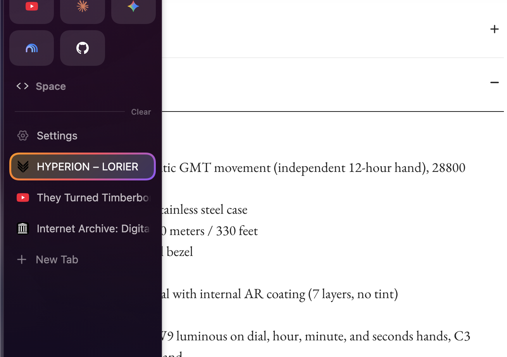
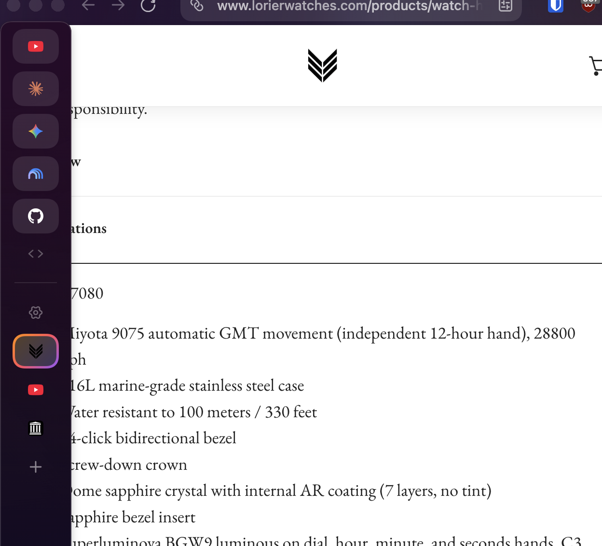

# Active Tab Halo

A custom [Zen Browser](https://zen-browser.app/) mod that highlights **only the active tab** with a Firefox-style `2.5px` orange-to-purple gradient border and subtle surface tint.

## Preview

| Full-Size Sidebar | Compact Sidebar |
| :---: | :---: |
|  |  |

## Features
- **Active Tab Only**: Leaves inactive tabs clean and unstyled.
- **Firefox Gradient Style**: Uses a `2.5px` Firefox orange-to-purple (`#ff9400` → `#ff4f5e` → `#9059ff`) border and subtle surface tint.
- **Universal Tab Support**: Works on standard tabs, Multi-Account Container tabs, tab groups, and Zen Essential tabs.
- **Sidebar Compatible**: Works seamlessly in both the compact (collapsed icon-only) tab sidebar and the full-size (expanded) tab sidebar.

## Install from GitHub

1. **Clone the repository and run the sync script:**
   ```zsh
   git clone https://github.com/Rory-Miley/zen_mods.git
   cd zen_mods
   ./dev/sync-mods.sh active-tab-halo
   ```
2. **Apply in Zen Browser:**
   - Open `about:preferences#zenMarketplace` (**Settings → Look and Feel → Zen Mods**).
   - Toggle **Active Tab Halo** off and back on (or restart Zen Browser).
